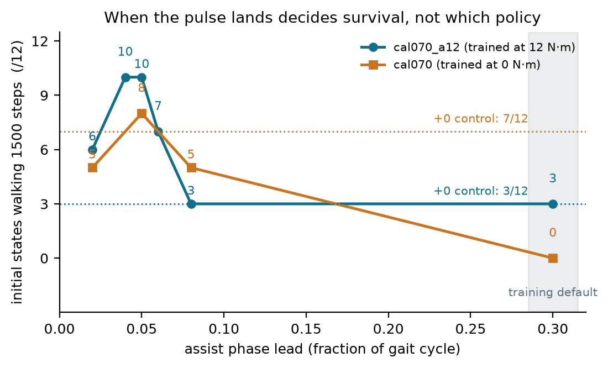
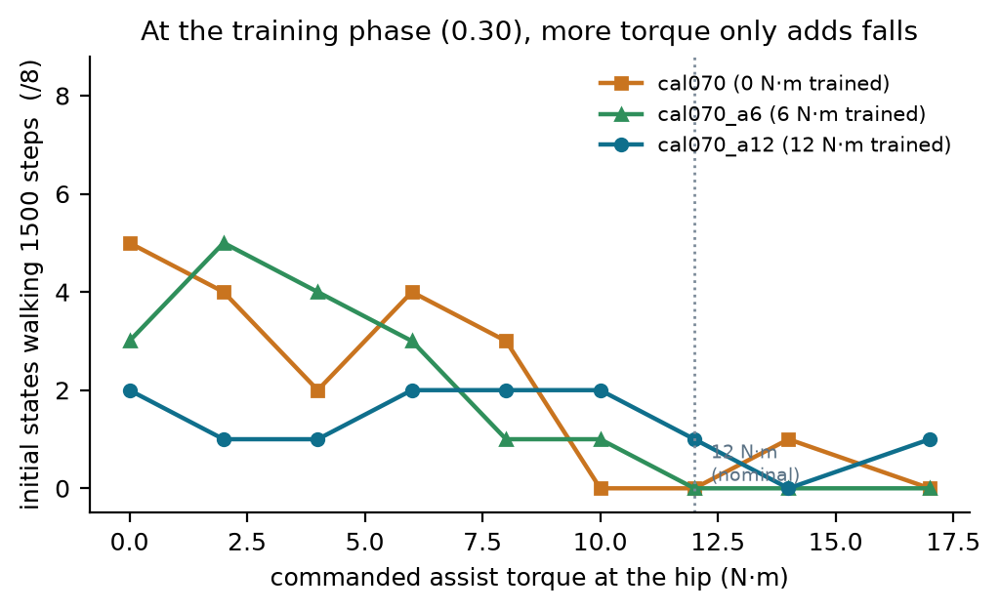
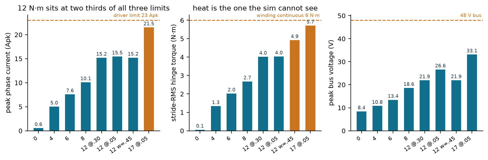
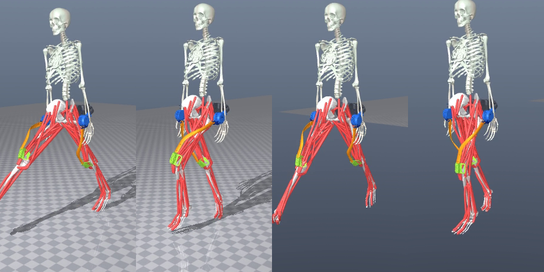
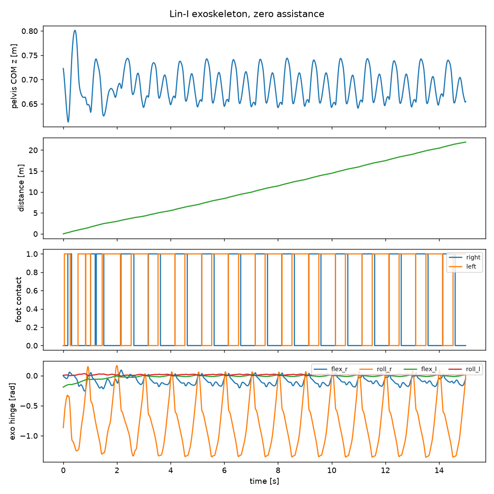
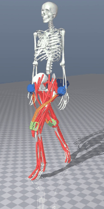
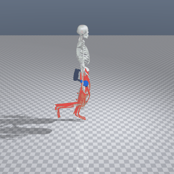

# Lin-I 髋外骨骼 · MuJoCo / MyoSuite 仿真


Lin-I 髋部外骨骼在 MyoSuite 人体肌骨模型上的 CAD 级仿真，以及配套的佩戴摆放、驱动建模、
可视化、验收和训练工具。仓库里有两套构型：

- **被动构型**：每侧一个髋模块，模块里有屈曲与外展两个铰链、坐在鼓形端盖上的曲折杆（叉架）、
  挂在销轴上的平行大腿长杆、销-槽滑移副，以及把连杆耦合到股骨的柔性焊缝（大腿绑带）。
  没有任何电机输出，行走时由绑带拖着长杆沿大腿运动。
- **驱动构型**：在被动构型上给每侧髋铰链挂一台 **RobStride RS02** 准直驱模块，用 MuJoCo 原生
  `<dcmotor>` 建模其电气链，并叠加一个相位锁定的辅助控制器。本文档后半部分全部关于这一层。

---

## 仓库内容

| | |
|---|---|
| **环境** | `myoLegWalkExo-v0`：`myoLegWalk-v0` + Lin-I；`myoLegWalkExoLocked-v0` 用刚性方式画出同一装置，便于对照 |
| **装置** | 每侧 5 个被动自由度（外展、屈曲、曲柄销、滑槽、连杆滚转），3 kg 按 CAD 质量分布附加，每侧一条柔性点焊缝（大腿绑带）；可选压垫式袖带（`exo_strap_preload_N`） |
| **驱动** | 每侧 1 台 RS02：`<dcmotor>`（反电动势、绕组电阻、力矩常数、驱动器饱和、折合转子惯量），48 V 母线，17 N·m 峰值 / 6 N·m 连续 |
| **策略** | `walk_exo_policy.zip`：从官方 `myoLegWalk-v0` 策略出发的 PPO 微调，零助力；`finetuned_cal070_a12.zip`：肌力标定到人体尺度（0.70）、按 12 N·m 辅助训练 |
| **验收** | 1500/1500 控制步（15 s）、前进 ~21 m、左右交替触地；辅助构型在 lead 0.05 下 12 个受扰初态里 10 个走满 |
| **测试** | 266 项：设备几何/焊缝、驱动电气链（T-N 包络、堵转电流、折合惯量、力矩请求往返）、观测契约、复位可复现、运行时几何一致性 |

## 驱动与电气链

老师的问题是「怎么让仿真表现出真实外骨骼的性能，重点是电气关系」。这里的做法不是给关节写一个
力矩源，而是把驱动当成一个**有电压、有反电动势、会被驱动器限流**的电气器件：

| 量 | 取值 | 来源 |
|---|---|---|
| 力矩常数 K（转子侧） | 0.144254 N·m/A | 由空载转速反推：`K = V / (N·ω_no_load)` |
| K 的第二条路径 | 0.14544 | 用 36 V 的 T-N 曲线零力矩点复拟合，与上一条 **99.2% 一致** |
| 绕组电阻 R_eff | 1.42432 Ω | 48 V 曲线从 17 N·m 点（225 rpm）到零力矩点（410 rpm）的斜率，复现公开曲线而非理想化直线 |
| 减速比 / 母线 | 7.75:1 / 48 V（24–60） | 说明书 |
| 驱动限流 | 23 Apk | 说明书；仿真里 `saturation` 是实际生效的，不是装饰 |
| 折算到关节 | K·N = 1.118 N·m/Arms | 6 N·m 连续 = 5.37 Arms |

关键点：**17 N·m 这个峰值不是写死的常数**。仿真跑到 17 N·m 处方时，峰值相电流是 **21.5 Apk**，
正好是驱动器 23 Apk 的 **93%** —— 峰值是限流造成的，模型自己算出来的。电气极限之外的堵转力矩是
37.7 N·m，所以"17 N·m"这条线本质上是电流上限的映射。

驱动日志逐步记录 `voltage / current / saturated / delivered_hinge_torque`，因此可以拿任何一条处方
去和真机的三条边界对账（见下图右侧三格）。

## 结果

### 1. 辅助落点决定能不能走，而不是策略多强

同一批 12 个受扰初态（位置/速度噪声 0.001），只改相位超前：



`cal070_a12`（按 12 N·m 训练）在 **lead 0.04–0.05 有 10/12 走满**，而它训练时的默认相位 0.30 只有
**3/12**；未按辅助训练的 `cal070` 也在 0.05 从 7/12 提到 **8/12**。**策略一个字没改，只移动了脉冲落点。**
幅值调到 17 N·m 也不会更好——见下一张。

### 2. 力矩再大也不会更好：上限在穿戴界面



在训练相位（0.30）上，0→17 N·m 的扫描里最好的点反而是 **0 N·m 的 5/8**，加大力矩只增加跌倒。
原因不在电机：台架实测**夹紧式袖带**的力矩传递只有约 **1.0**（左右 −1.065 / +1.003，1–17 N·m、25–400 N
预紧范围内平到 2%），而原来的点连接焊缝只有 **~0.12** —— 电机给的力矩到不了髋关节。

### 3. 把驱动日志和 RS02 的三条边界对账



12 N·m @ lead 0.05 的处方落在**三条边界的 67% / 67% / 55%**（峰值电流 15.5 Apk、逐步 RMS 4.04 N·m、
峰值母线 26.6 V），说明它既不会撞驱动限流，也不会在电压上触顶，热上也有余量。17 N·m 处方则到
**93% / 95%**——电气上几乎贴线，真机上只能短时使用。

热的另一条结论：由说明书两点（6 N·m 无限、13 N·m 42 s）反推的一阶热时间常数 **τ ≈ 175 s**，
另一组数据（17 N·m 10 s 运行 / 6 s 停 = 16 s 内 13.4 N·m RMS）算出来只到稳态温升的 43%，两者自洽。
按这个模型，能走 5 分钟的关节 RMS 上限约 **6.6 N·m**，所以 12 N·m @ duty 0.25 的处方可以整班用，
17 N·m 只能短时。

### 4. 训练买到了什么

| 训练 | 训练时条件 | 冻结策略的 A/B（受扰初态存活） |
|---|---|---|
| 基线微调 | 无外骨骼 | 名义 **1500/1500**；受扰 +0 5/8 |
| 肌力标定 0.68–0.90 | 力标定 | **0.70 是还能走的最深一档**（0.68 崩），但仍约为人体 2.5 倍 |
| `cal070_a6` | 6 N·m | +6 → 3/8，+12 → 0/8 |
| `cal070_a12` | 12 N·m @ 0.30 | 同相位 1/8；换到 lead 0.05 → **10/12** |
| 能耗权重 on/off | ± | 7/8 对 7/8，**零结果**（模型肌肉在 fs=1.0 下本来就超人类 2–4 倍） |
| 在 0.05 上再训 15 万步 | 12 N·m @ 0.05 | **6/12，比训练前的 10/12 更差**（KL 每次 0.03–0.04 触发 early stop） |

结论：训练能让策略**耐受训练过的那一档辅助**，但买不来跨相位的鲁棒性；把相位调对，收益比再训多少步都大。

## 图片与视频

被动构型 15 秒行走的一个步态循环（从左到右）：



验收曲线：质心高度、累计位移（15 s 走 21.9 m）、左右足触地、外骨骼四个被动铰链角度：



被动行走循环（GIF，5 秒）：



完整 15 秒视频：[docs/videos/walk_15s.mp4](docs/videos/walk_15s.mp4)

**驱动构型**（12 N·m @ lead 0.05，肌力标定 0.70，压垫袖带 50 N）：



完整 15 秒视频：[docs/videos/walk_assist_15s.mp4](docs/videos/walk_assist_15s.mp4)

## 快速上手

```bash
pip install -e .                                        # 以可编辑方式安装 MyoSuite

python scripts/view_walk_exo.py                         # 看自带策略行走
python scripts/view_walk_exo.py --no-policy             # 停在复位位姿，鼠标拖动观看
python scripts/eval_walk_exo.py --policy walk_exo_policy.zip   # 15 秒验收
pytest myosuite/tests/test_lin1_exo.py myosuite/tests/test_lin1_exo_drive.py
```

带驱动的验收（肌力标定 + 压垫袖带 + 12 N·m @ lead 0.05）：

```bash
python scripts/eval_walk_exo.py --policy finetuned_cal070_a12.zip --seed 0 \
       --assist-torque 12 --assist-phase-lead 0.05 --assist-width 0.30 \
       --strap-preload 50 --muscle-force-scale 0.70 --json assist.json
```

冻结策略的配对 A/B（同一批受扰初态上比较处方，策略权重不动）：

```bash
python scripts/frozen_ab_walk_exo.py --policy finetuned_cal070_a12.zip \
       --assist-torque 0 12 --assist-phase-lead 0.05 --assist-width 0.30 \
       --strap-preload 50 --muscle-force-scale 0.70 \
       --seeds 0 1 2 3 4 5 6 7 8 9 10 11 --init-noise 0.001 --vel-noise 0.001
```

重新训练一个控制器（把官方策略微调到外骨骼环境）：

```bash
python scripts/finetune_walk_exo.py --resume walk_exo_policy.zip \
       --steps 1500000 --n-envs 4 --target-kl 0.08 --eval-every 50000
python scripts/finetune_walk_exo.py --resume finetuned_cal070_a12.zip --exo-motor \
       --assist-torque 12 --assist-phase-lead 0.05 --assist-width 0.30 \
       --strap-preload 50 --muscle-force-scale 0.70 --lr 3e-5 --target-kl 0.02 --steps 150000
```

几个踩过的坑：评估 SB3 的 `.zip` 必须用 `--policy`（`--checkpoint` 是 rsl_rl 格式的加载器，会让任何
策略都只跑 43 步就倒）；一次训练的**最后**检查点可能退化，要逐个扫 `finetune_ckpt/ppo_*_steps.zip`；
`--init-noise` 默认 0.004，和之前记录的结果对比时要用 0.001，否则不是同一批初态。

## 目录结构

```
myosuite/envs/myo/tasks/basic/leg/lin1_exo.py   装置：CAD 部件、铰链、绑带焊缝、佩戴摆放、dcmotor
myosuite/envs/myo/tasks/basic/leg/walk_exo.py   两个外骨骼环境 + 佩戴/驱动/辅助旋钮
myosuite/envs/myo/assets/leg/lin1_exo/          meshes/ 为 SolidWorks 导出的 STL；params.json 含实测与拟合参数
myosuite/tests/test_lin1_exo.py                 设备测试
myosuite/tests/test_lin1_exo_drive.py           驱动电气链测试
scripts/view_walk_exo.py                        交互查看器
scripts/eval_walk_exo.py                        验收（可出 JSON、曲线、离屏帧）
scripts/frozen_ab_walk_exo.py                   冻结策略的配对 A/B
scripts/finetune_walk_exo.py                    把策略微调到外骨骼环境
scripts/make_walk_video.py                      把离屏帧编码成 mp4
```

## 已知简化

1. **没有热状态**：只验到电气包络；「连续走会不会过热」由外挂的一阶热模型（τ≈175 s）回答，仿真里看不到。
2. **没有建模 0.5 Arms 空载摩擦**（关节上约 0.6 N·m 库仑损失）与电感（L≈0，1 kHz 电流环下可忽略）。
3. 电气参数目前只有**说明书一条验证路径**，还没有第二台真机/台架实测对照。

---

<sub>English summary: a CAD-accurate Lin-I hip exoskeleton in MyoSuite, in a passive build (five passive DOF
per side, the thigh link coupled to the femur by a compliant strap weld, zero motor torque) and a powered
build that hangs one RobStride RS02 per hip hinge behind MuJoCo's native `<dcmotor>` — back-EMF, winding
resistance, fitted torque constant, driver saturation and reflected rotor inertia — with a phase-locked
assist controller on top. The electrical fit reproduces the datasheet's torque-speed curve and lands the
17 N·m peak at 21.5 Apk, i.e. 93% of the driver's 23 Apk, so the peak comes out of the current limit rather
than a constant. Where the assist pulse lands dominates everything else: moving the lead from the training
default 0.30 to 0.05 takes the same frozen policy from 3/12 to 10/12 perturbed initial states, while more
torque (up to 17 N·m) buys nothing because the clamped cuff transfers the moment at ~1.0 and the original
point weld only ~0.12. A 12 N·m pulse at the corrected phase draws 67% of the driver current, 67% of the
winding's continuous torque and 55% of the 48 V bus; 17 N·m sits at 93/95% and is therefore a burst, not a
walking prescription.</sub>
