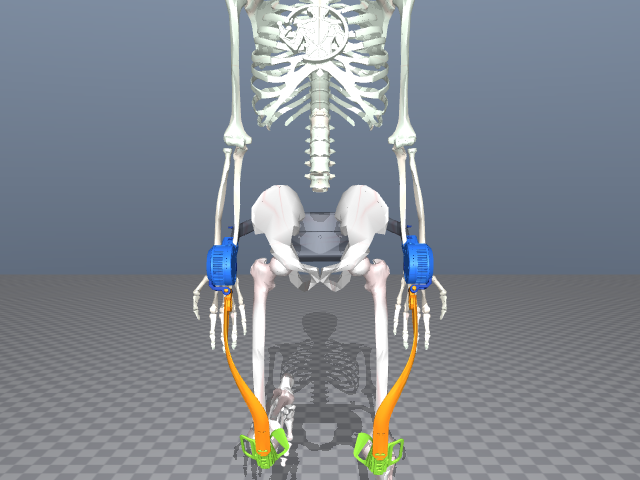
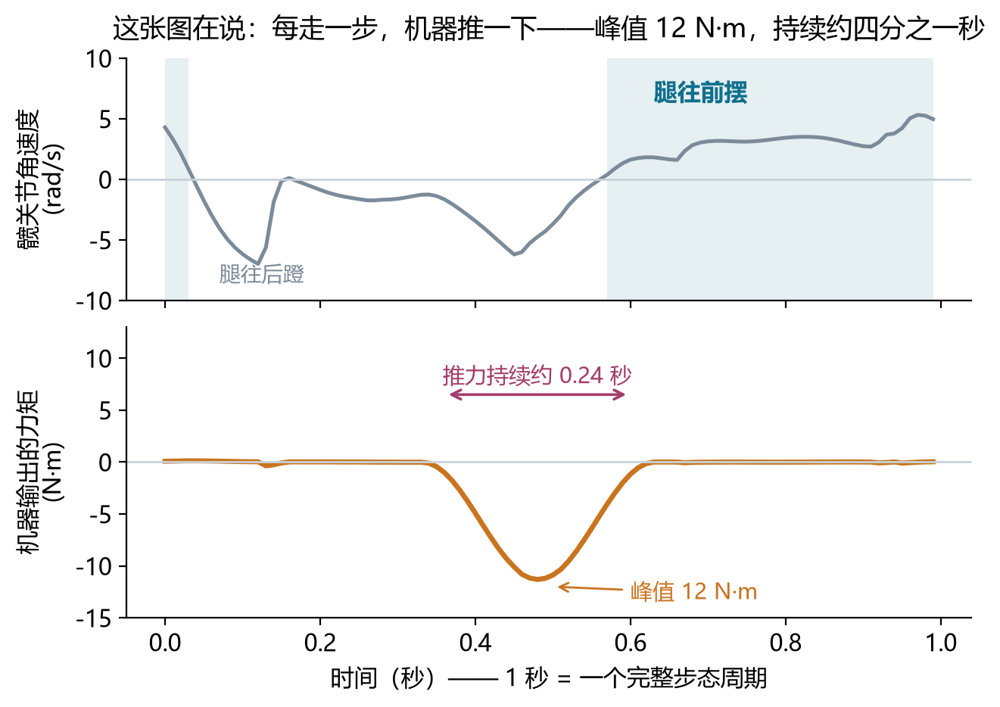
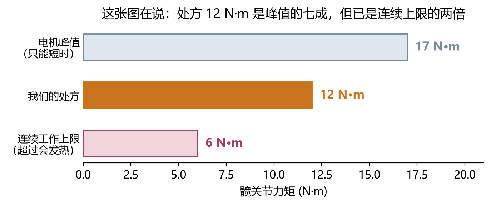
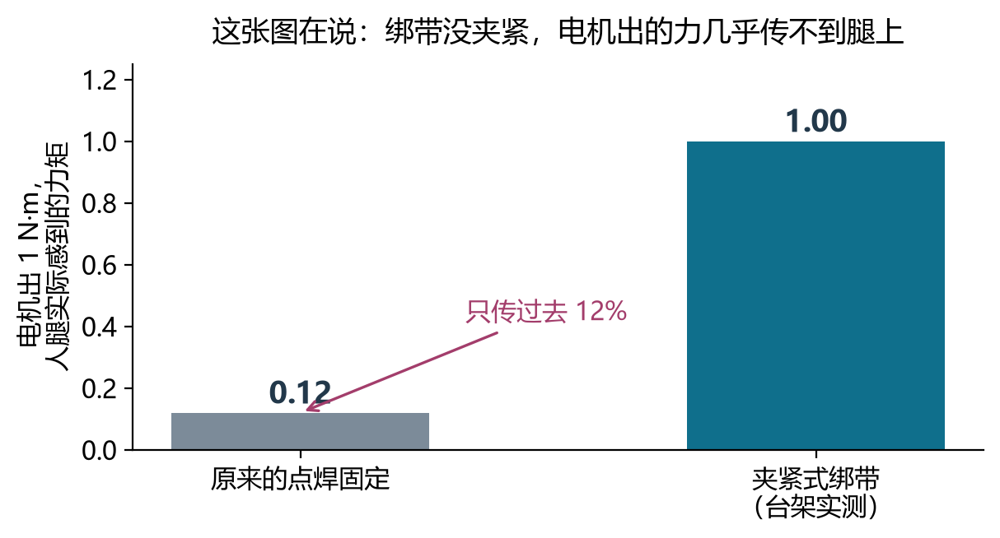
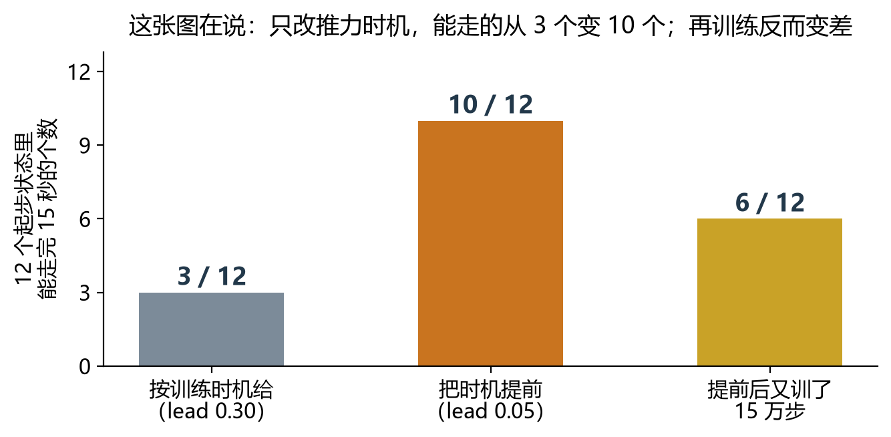
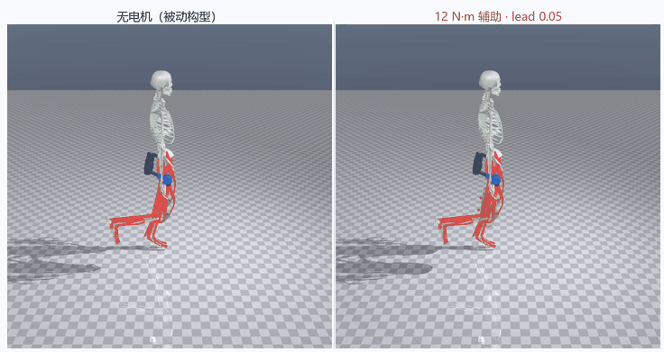

# Lin-I 髋外骨骼 · MuJoCo / MyoSuite 仿真



把 **Lin-I 髋关节外骨骼**搬进 MyoSuite 的人体肌骨模型。装置有两个版本：不带电机的**被动版**，
和每侧髋装一台 **RobStride RS02** 电机的**驱动版**。

驱动版的重点是电气：电机不是"直接给一个力矩"，而是给**电压**，由反电动势、绕组电阻和驱动器
限流算出力矩——这样仿真里的力矩输出才有真机的脾性。

下面四张图按"帮不帮得上"的顺序讲完这件事。

## 一、机器怎么帮



每走一步，机器推一下：**峰值 12 N·m，持续约四分之一秒**。上图是髋关节的角速度（为正表示腿在往前摆），
下图是机器实际输出的力矩。命令和实际输出最多只差 0.56 N·m。

## 二、12 N·m 是什么概念



电机峰值能出 17 N·m，但只能撑很短时间；能一直出的只有 6 N·m。**我们的处方 12 N·m 是峰值的七成，
却是连续上限的两倍**——短时走没问题，长时间走会发热。

## 三、电机出的力，腿上能感觉到多少



电机在髋关节出 1 N·m，人腿实际感到的力矩：原来的点焊固定只有 **0.12**，换成夹紧式绑带（台架实测）是
**1.0**。这就是为什么早先加大力矩没有用——力都耗在绑带打滑上了。

## 四、为什么"什么时候推"比"推多大力"重要



12 个不同的起步状态，看能走满 15 秒的有几个。用训练时的时机推，只有 **3 个**能走；把推力提前
0.05 个步态周期，变成 **10 个**——策略一个字没改。反过来，在提前后的时机上再训练 15 万步，
掉到 **6 个**。所以缺的不是训练，是时机。

## 并排看

左边不带电机，右边 12 N·m 辅助。同一机位、同一条时间轴：



完整 15 秒（左右并排）：[docs/videos/walk_compare_15s.mp4](docs/videos/walk_compare_15s.mp4)

## 电气模型是怎么做的

- 用 MuJoCo 原生 `<dcmotor>`：反电动势、绕组电阻、力矩常数、电流限幅、转子惯量折合到关节。
- 力矩常数和绕组电阻都是从厂家曲线拟合的，再用第二个电压点交叉验证（两条路径 99.2% 一致）。
- 所以 17 N·m 这个峰值不是写死的：仿真跑到 17 N·m 时电流正好是驱动器上限的 93%，是限流造出来的。
- 每一步都记录电压、电流、是否饱和、实际输出力矩，任何一条处方都能拿去和真机边界对账。

## 怎么跑

```bash
pip install -e .

# 看被动版行走
python scripts/view_walk_exo.py

# 带电机、12 N·m 辅助的验收
python scripts/eval_walk_exo.py --policy finetuned_cal070_a12.zip \
       --assist-torque 12 --assist-phase-lead 0.05 --strap-preload 50 \
       --muscle-force-scale 0.70 --steps 1500

# 在同一批初态上比较两种处方（策略权重不动）
python scripts/frozen_ab_walk_exo.py --policy finetuned_cal070_a12.zip \
       --assist-torque 0 12 --assist-phase-lead 0.05 --seeds 0 1 2 3 4 5
```

## 目录

```
myosuite/envs/myo/tasks/basic/leg/lin1_exo.py   装置几何 + 电机
myosuite/envs/myo/tasks/basic/leg/walk_exo.py   环境（佩戴 / 驱动 / 辅助旋钮）
myosuite/tests/                                 266 项测试
scripts/                                        查看、验收、A/B、训练、出视频
```

## 还没做的

- **发热没建模**。上面说的"连续 6 N·m"是额定值；走久了会不会过热，仿真里看不到。
- 空载摩擦（关节上约 0.6 N·m）和电感没有建模。
- 电气参数目前只有说明书这一条验证路径，还没有真机台架对照。

---

<sub>English: a CAD-accurate Lin-I hip exoskeleton in MyoSuite, passive and with one RobStride RS02 per hip
behind MuJoCo's native DC-motor model, so torque comes out of a voltage command and the driver's current
limit rather than a constant. The 12 N·m prescription is two thirds of the peak and twice the continuous
rating; moving its timing by 0.05 of a gait cycle takes the same frozen policy from 3/12 to 10/12
perturbed initial states, while more torque buys nothing because the strap, not the motor, is the ceiling.</sub>
