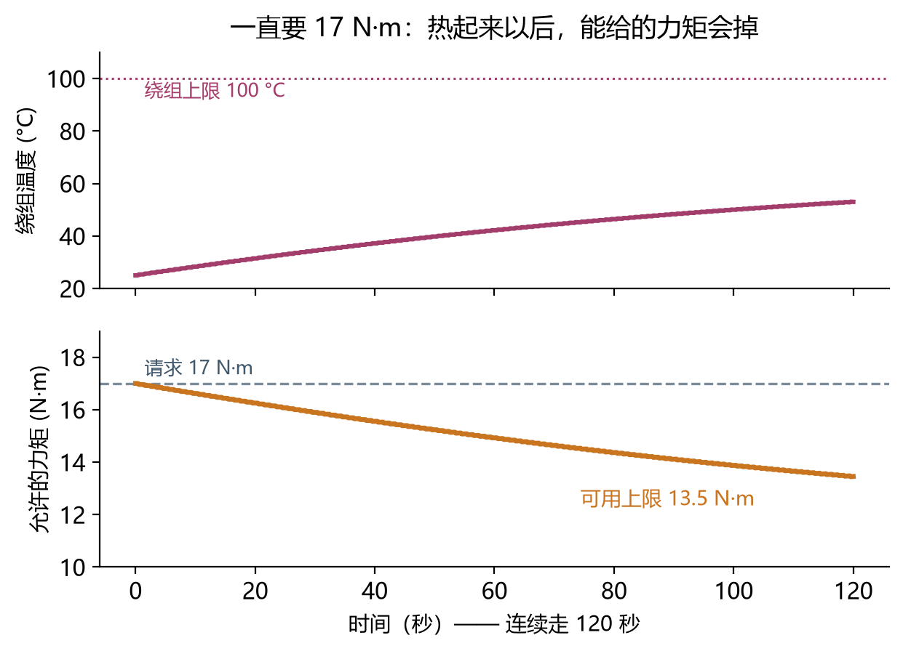

# Lin-I 髋外骨骼 · MuJoCo / MyoSuite 仿真


Lin-I 髋关节外骨骼装进 MyoSuite 人体肌骨模型的仿真仓库。每侧髋挂一台 **RobStride RS02**，
分「被动」（无电机）和「辅助」两种构型。

驱动是按电气关系建的：力矩由母线电压、转速、绕组电阻和驱动器限流算出来，而不是在关节上写死一个
力矩常数。所以转快了、电流顶到限流、电压掉了，能出的力矩都会跟着变。

下面四张图讲的就是这套驱动在仿真里的表现：**力矩输出 → 力矩-转速能力 → 额定力矩 → 发热**。
这里只说仿真里发生了什么，不谈和真机像不像。

## 一、力矩输出


一个步态周期（1 秒）里：

- **上面**：电机实际输出的力矩，两条腿各被推一次，峰值 12 N·m。
- **中间**：对应的电流，峰值 **10.9 A**，是驱动器上限 16 A 的 **67%**。
- **下面**：端电压，峰值 **26.6 V**，只用了 48 V 电源的一半。

## 二、力矩-转速能力


转速越快，能给的力矩越小。**17 N·m 这条平线是驱动器限流，不是电机本身的极限**——把电流限流拿掉，
静止时它能出 37.7 N·m。仿真里只用到 0–100 转/分、12 N·m 以内那一块（图中虚线框），离"高速出不了力"
那一端还很远，所以在这套仿真里限制力矩的是电流，不是转速。

## 三、额定力矩


电机峰值 17 N·m 只能短时用，能一直出的只有 6 N·m。**处方 12 N·m 是峰值的七成，却是连续上限的两倍**：
短时走没问题，长走会发热。

## 四、发热



驱动器一直要 17 N·m 的话，绕组从 25 °C 开始升，两分钟到 53 °C，能给的力矩从 17 掉到 **13.5 N·m**。
而 12 N·m 的走路处方跑一分钟只升到 33.6 °C，按这个模型稳态约 59 °C，**不会触发热降额**。

模型是一阶的：时间常数 175 s 由说明书两个点反推（6 N·m 无限、13 N·m 42 s），升温按力矩平方算，
6 N·m 时稳态正好落在设定的 100 °C 绕组上限。温度在每次 reset 时回到室温，所以正常 15 秒的验收
跑不出这个效应，要看长时间才看得到。

热起来还会改电气：铜的电阻按 0.00393/K 上升，到 100 °C 时是冷态的 1.30 倍，同样 12 N·m 的力矩
（零速时）要从 15.3 V 变成 19.8 V。仿真里这个电阻是每步写回 `<dcmotor>` 的。

## 并排看

左边不带电机，右边 12 N·m 辅助。同一机位、同一条时间轴：


完整 15 秒（左右并排）：[docs/videos/walk_compare_15s.mp4](docs/videos/walk_compare_15s.mp4)

## 电气模型是怎么做的

- 用 MuJoCo 原生 `<dcmotor>`：反电动势、绕组电阻、力矩常数、电流限幅、转子惯量折合到关节。
- 力矩常数和绕组电阻取自厂家参数表的曲线，再用第二个电压点交叉验证（两条路径 99.2% 一致）。
- 所以 17 N·m 这个上限不是写死的：仿真跑到 17 N·m 时电流正好是驱动器上限的 93%，是限流造出来的。
- 每一步都记录电压、电流、是否饱和、实际输出力矩，可以直接拿来看某条处方的电气工作点。

另外，把这段推力**提前 0.05 个步态周期**，12 个受扰起步状态里能走满 15 秒的从 3 个变成 10 个。
把扰动放大 4 倍换成更难的一批状态后，最优点挪到 0.06、增益缩到 7 个（控制 4 个），但按训练相位
0.30 给仍然是 **0 个**——"相位错了会帮倒忙"比"能多救几个"更稳定。两批数据在
`docs/data/phase_noise_sweep.json`，用 `scripts/frozen_ab_walk_exo.py` 可复现。

## 怎么跑

```bash
pip install -e .        # 依赖里 mujoco >= 3.16（3.16 与 3.17 都跑过全部测试）

# 看被动版行走
python scripts/view_walk_exo.py

# 重新生成前三张图（数据在 docs/data/，一次 12 N·m 处方的 1500 步驱动日志）
python scripts/make_figures.py

# 跑一次热降额演示（120 秒、17 N·m）并出图
python scripts/thermal_demo.py 120 thermal_run.json 17
python scripts/make_thermal_figure.py --data thermal_run.json

# 带电机、12 N·m 辅助的验收
python scripts/eval_walk_exo.py --policy finetuned_cal070_a12.zip \
       --assist-torque 12 --assist-phase-lead 0.05 --strap-preload 50 \
       --muscle-force-scale 0.70 --steps 1500

# 在同一批初态上比较两种处方（策略权重不动）
python scripts/frozen_ab_walk_exo.py --policy finetuned_cal070_a12.zip \
       --assist-torque 0 12 --assist-phase-lead 0.05 --seeds 0 1 2 3 4 5
```

## 目录

```
myosuite/envs/myo/tasks/basic/leg/lin1_exo.py   装置几何 + 电机
myosuite/envs/myo/tasks/basic/leg/walk_exo.py   环境（佩戴 / 驱动 / 辅助旋钮）
myosuite/tests/                                 273 项测试
scripts/                                        查看、验收、A/B、训练、出视频
finetuned_cal070_a12.zip                        本页所有结果用的策略（12 N·m 训练、肌力 0.70）
```

## 还没做的

- 热模型只有时间常数来自说明书；100 °C 的绕组上限是按绝缘等级假设的，没有实测。
- 电机的空载摩擦有开关（`exo_drive_friction_Nm`，按 0.5 Arms 折算约 0.56 N·m），但默认关着：
  现有策略是在没有它的模型上训的。打开后原策略仍能走满 15 秒（21.3 m，不开是 21.9 m）。
- 电感没有建模。
- 电机参数取自厂家参数表，这个仿真本身不做真机测量。

---

<sub>English: a CAD-accurate Lin-I hip exoskeleton in MyoSuite with one RobStride RS02 per hip behind
MuJoCo's native DC-motor model, so torque comes out of a voltage command and the driver's current limit
rather than a constant: the delivered hinge torque tracks the command to within 0.56 N·m, drawing 67% of
the driver's current and 55% of the 48 V bus. The 17 N·m plateau is the current limit, not the motor —
an unrestricted stall would reach 37.7 N·m — and a 12 N·m prescription is seven tenths of that peak but
twice the module's continuous rating.</sub>
