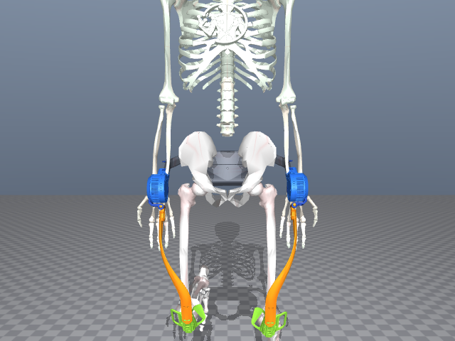
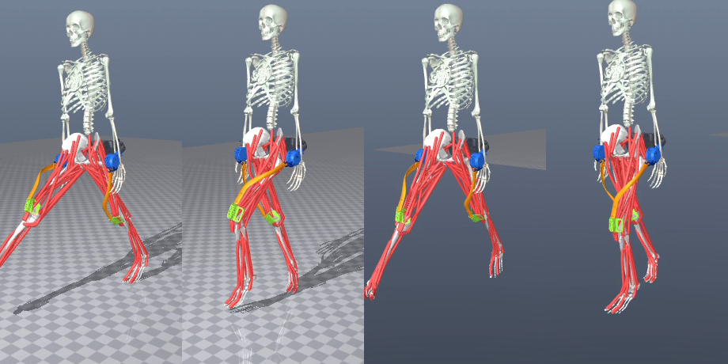
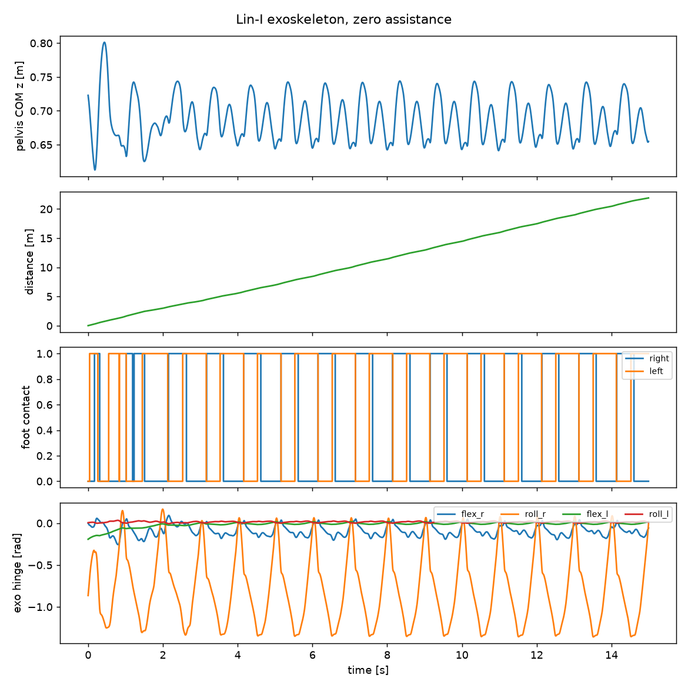
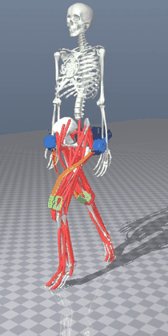

# Lin-I 被动髋外骨骼 · MuJoCo / MyoSuite 仿真



Lin-I 髋部外骨骼在 MyoSuite 人体肌骨模型上的 CAD 级仿真，以及配套的佩戴摆放、可视化、验收和训练工具。装置本身**完全被动**：每侧一个髋模块，模块里有屈曲与外展两个铰链、坐在鼓形端盖上的曲折杆（叉架）、挂在销轴上的平行大腿长杆、销-槽滑移副，以及把连杆耦合到股骨的柔性焊缝（大腿绑带）。没有任何电机输出，行走时由绑带拖着长杆沿大腿运动。

---

## 仓库内容

| | |
|---|---|
| **环境** | `myoLegWalkExo-v0`：`myoLegWalk-v0` + Lin-I；`myoLegWalkExoLocked-v0` 用刚性方式画出同一装置，便于对照 |
| **装置** | 每侧 5 个被动自由度（外展、屈曲、曲柄销、滑槽、连杆滚转），3 kg 按 CAD 质量分布附加，每侧一条柔性点焊缝（大腿绑带） |
| **策略** | `walk_exo_policy.zip`：从官方 `myoLegWalk-v0` 策略出发的 PPO 微调，零助力 |
| **验收** | 1500/1500 控制步（15 s）、前进 21.9 m、两侧外骨骼铰链扭矩 0 Nm、左右交替触地 |
| **测试** | `myosuite/tests/test_lin1_exo.py`：17 项（CAD 部件、焊缝耦合、叉耳座落、复位焊缝、绑带拖拽） |

## 图片与视频

15 秒行走的一个步态循环（从左到右）：



验收曲线：质心高度、累计位移（15 s 走 21.9 m）、左右足触地、外骨骼四个被动铰链角度：



行走循环（GIF，5 秒）：



完整 15 秒视频：[docs/videos/walk_15s.mp4](docs/videos/walk_15s.mp4)

## 快速上手

```bash
pip install -e .                                        # 以可编辑方式安装 MyoSuite

python scripts/view_walk_exo.py                         # 看自带策略行走
python scripts/view_walk_exo.py --no-policy             # 停在复位位姿，鼠标拖动观看
python scripts/eval_walk_exo.py --policy walk_exo_policy.zip   # 15 秒验收
pytest myosuite/tests/test_lin1_exo.py                  # 设备自身测试
```

重新训练一个控制器（把官方策略微调到外骨骼环境）：

```bash
python scripts/finetune_walk_exo.py --resume walk_exo_policy.zip \
       --steps 1500000 --n-envs 4 --target-kl 0.08 --eval-every 50000
python scripts/eval_walk_exo.py --policy finetune_ckpt/ppo_1400000_steps.zip
```

两个踩过的坑：评估 SB3 的 `.zip` 必须用 `--policy`（`--checkpoint` 是 rsl_rl 格式的加载器，会让任何策略都只跑 43 步就倒）；一次训练的**最后**检查点可能退化，要逐个扫 `finetune_ckpt/ppo_*_steps.zip`，留第一个通过验收的。

## 目录结构

```
myosuite/envs/myo/tasks/basic/leg/lin1_exo.py   装置：CAD 部件、铰链、绑带焊缝、佩戴摆放
myosuite/envs/myo/tasks/basic/leg/walk_exo.py   两个外骨骼环境 + 佩戴旋钮
myosuite/envs/myo/assets/leg/lin1_exo/meshes/   SolidWorks 导出的 STL 零件
myosuite/tests/test_lin1_exo.py                 设备测试
scripts/view_walk_exo.py                        交互查看器
scripts/eval_walk_exo.py                        15 秒验收
scripts/finetune_walk_exo.py                    把策略微调到外骨骼环境
scripts/diag_exo_*.py                           调参时用的诊断脚本
walk_exo_policy.zip                             自带的 15 秒行走策略
```

---

<sub>English summary: a CAD-accurate model of the Lin-I passive hip exoskeleton in MyoSuite — five passive DOF per side, the thigh link coupled to the femur by a compliant strap weld, zero motor torque — shipped with a fine-tuned policy that walks 15 s (1500 steps, 21.9 m), an acceptance script, an interactive viewer and 17 device tests.</sub>
