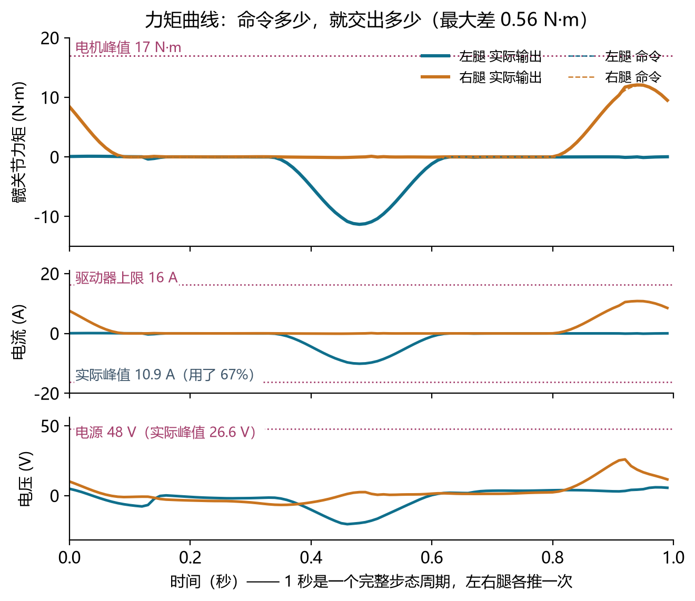
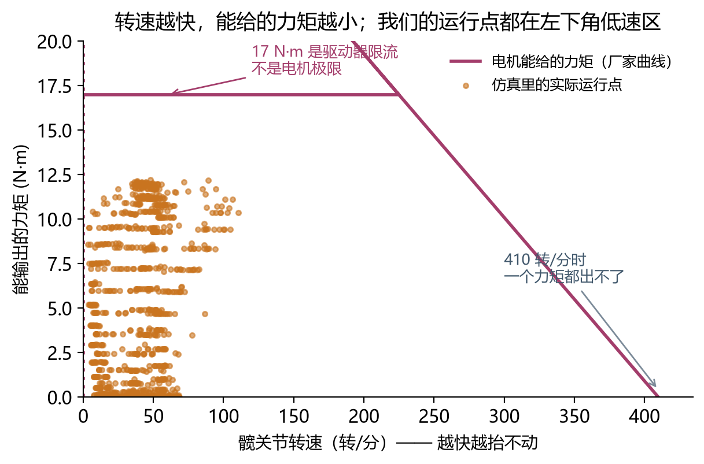
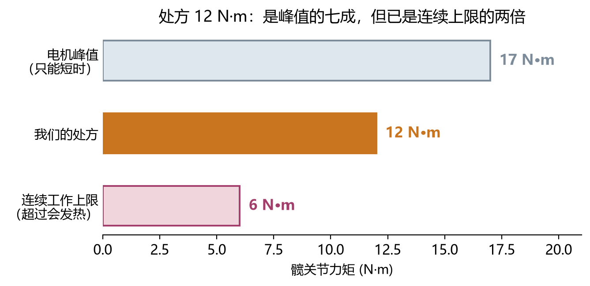

# Lin-I 髋外骨骼 · MuJoCo / MyoSuite 仿真


把 **Lin-I 髋关节外骨骼**搬进 MyoSuite 的人体肌骨模型，每侧髋挂一台 **RobStride RS02** 电机。

这是一个**仿真**：驱动按电气关系建模，力矩由电压、电流和驱动器限流算出来，而不是在关节上直接
写一个力矩常数。所以速度、电流上限、母线电压一变，能出的力矩也会跟着变。下面三张图讲这套驱动
在仿真里的表现。

## 一、力矩曲线：命令多少，就交出多少



一个步态周期（1 秒）里：

- **上面**：电机实际输出的力矩，两条腿各被推一次，峰值 12 N·m。
- **中间**：对应的电流，峰值 **10.9 A**，是驱动器上限 16 A 的 **67%**。
- **下面**：端电压，峰值 **26.6 V**，只用了 48 V 电源的一半。

## 二、能出多大，到哪为止



转速越快，能给的力矩越小。**17 N·m 这条平线是驱动器限流，不是电机本身的极限**——把电流限流拿掉，
静止时它能出 37.7 N·m。仿真的运行点都挤在左下角（0–100 转/分、10 N·m 上下），离"高速出不了力"
那一端还很远，所以在这套仿真里限制力矩的是电流，不是转速。

## 三、12 N·m 处在什么位置



电机峰值 17 N·m 只能短时用，能一直出的只有 6 N·m。**处方 12 N·m 是峰值的七成，却是连续上限的两倍**：
短时走没问题，长走会发热。

## 并排看

左边不带电机，右边 12 N·m 辅助。同一机位、同一条时间轴：


完整 15 秒（左右并排）：[docs/videos/walk_compare_15s.mp4](docs/videos/walk_compare_15s.mp4)

## 电气模型是怎么做的

- 用 MuJoCo 原生 `<dcmotor>`：反电动势、绕组电阻、力矩常数、电流限幅、转子惯量折合到关节。
- 力矩常数和绕组电阻取自厂家参数表的曲线，再用第二个电压点交叉验证（两条路径 99.2% 一致）。
- 所以 17 N·m 这个上限不是写死的：仿真跑到 17 N·m 时电流正好是驱动器上限的 93%，是限流造出来的。
- 每一步都记录电压、电流、是否饱和、实际输出力矩，可以直接拿来看某条处方的电气工作点。

另外，把这段推力**提前 0.05 个步态周期**，12 个受扰起步状态里能走满 15 秒的从 3 个变成 10 个
——时机比幅值重要，这部分数据在 `scripts/frozen_ab_walk_exo.py` 里可以复现。

## 怎么跑

```bash
pip install -e .        # 依赖里 mujoco 钉在 3.16：3.17 改紧了 equality 参数形状，会挂掉驱动测试

# 看被动版行走
python scripts/view_walk_exo.py

# 重新生成下面三张图（数据在 docs/data/，一次 12 N·m 处方的 1500 步驱动日志）
python scripts/make_figures.py

# 带电机、12 N·m 辅助的验收
python scripts/eval_walk_exo.py --policy finetuned_cal070_a12.zip \
       --assist-torque 12 --assist-phase-lead 0.05 --strap-preload 50 \
       --muscle-force-scale 0.70 --steps 1500

# 在同一批初态上比较两种处方（策略权重不动）
python scripts/frozen_ab_walk_exo.py --policy finetuned_cal070_a12.zip \
       --assist-torque 0 12 --assist-phase-lead 0.05 --seeds 0 1 2 3 4 5
```

## 目录

```
myosuite/envs/myo/tasks/basic/leg/lin1_exo.py   装置几何 + 电机
myosuite/envs/myo/tasks/basic/leg/walk_exo.py   环境（佩戴 / 驱动 / 辅助旋钮）
myosuite/tests/                                 266 项测试
scripts/                                        查看、验收、A/B、训练、出视频
```

## 还没做的

- **发热没建模**。上面说的"连续 6 N·m"是参数表上的额定值；这套仿真里没有温度状态，跑久了会不会
  过热它回答不了。
- 空载摩擦（关节上约 0.6 N·m）和电感没有建模。
- 电机参数取自厂家参数表，这个仿真本身不做真机测量。

---

<sub>English: a CAD-accurate Lin-I hip exoskeleton in MyoSuite with one RobStride RS02 per hip behind
MuJoCo's native DC-motor model, so torque comes out of a voltage command and the driver's current limit
rather than a constant: the delivered hinge torque tracks the command to within 0.56 N·m, drawing 67% of
the driver's current and 55% of the 48 V bus. The 17 N·m plateau is the current limit, not the motor —
an unrestricted stall would reach 37.7 N·m — and a 12 N·m prescription is seven tenths of that peak but
twice the module's continuous rating.</sub>
